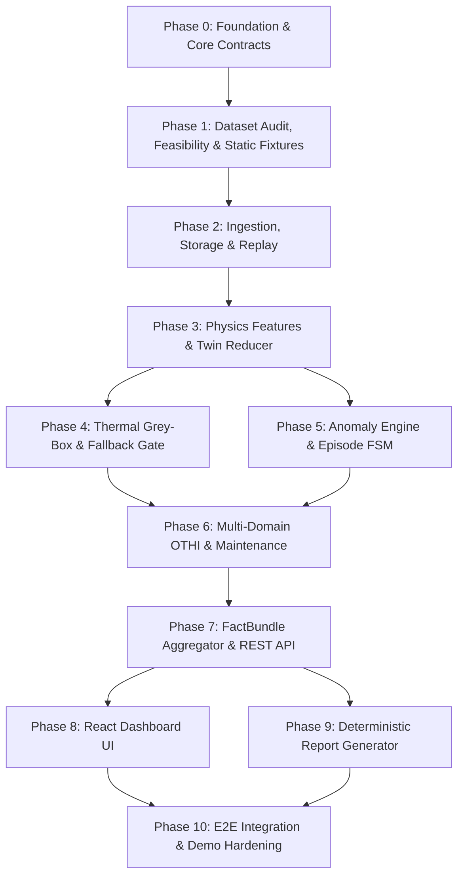

# Implementation Plan: Digital Twin for Distribution Transformer Health Monitoring

> [!NOTE]
> **HISTORICAL / SUPERSEDED DOCUMENTATION**  
> This document is the original hackathon implementation plan (Phases 1–10 baseline).  
> For the current authoritative execution roadmap, candidate dataset scope, audit logs, and technical references, consult:
> - [`GRIDPULSE_MASTER_EXECUTION_PLAN.md`](../GRIDPULSE_MASTER_EXECUTION_PLAN.md) — Primary Authoritative Execution Roadmap
> - [`GRIDPULSE_DATASET_SYN_ADAPTATION_AND_EXTRA_DOMAIN_SCOPE.md`](../GRIDPULSE_DATASET_SYN_ADAPTATION_AND_EXTRA_DOMAIN_SCOPE.md) — Candidate Adaptation & Extra Domains
> - [`docs/execution/GRIDPULSE_EXECUTION_LOG.md`](execution/GRIDPULSE_EXECUTION_LOG.md) — Verification & Audit Evidence
> - [`docs/references/TECHNICAL_REFERENCES_AND_CITATIONS.md`](references/TECHNICAL_REFERENCES_AND_CITATIONS.md) — Standards Citations & Bibliography

**Project:** POWERNext-AI Hackathon 2026 — Track 2: Digital Twin for Intelligent Health Monitoring and Predictive Maintenance of Distribution Transformers  
**Team:** SKY HIGH  
**Canonical Architecture Reference:** [`docs/FINAL_ARCHITECTURE_DECISIONS.md`](FINAL_ARCHITECTURE_DECISIONS.md)  
**Requirements & Scope References:** [`docs/MVP.md`](MVP.md), [`docs/SRS.md`](SRS.md), [`docs/PRINCIPLES.md`](PRINCIPLES.md), [`docs/CODING_RULES.md`](CODING_RULES.md)

---

## 1. Executive Summary & Engineering Governance

This plan establishes the complete, deterministic, dependency-ordered engineering blueprint for implementing the Distribution Transformer Digital Twin prototype. The system strictly adheres to the engineering boundaries, physical constraints, and data honesty rules established across the canonical architecture, SRS, MVP, and coding rules.

### Core Non-Negotiable System Principles
1. **Scope Honesty & Claim Boundaries:** Single-transformer prototype; zero claims of whole-life Remaining Useful Life (RUL) or whole-asset failure probabilities; no unsupported black-box fault classification; thermal exposure is expressed strictly as cumulative aging hours under IEEE C57.91 / IEC 60076-7 loss-of-life formulation only when verified paper insulation class and credible hot-spot estimates exist. Otherwise, the system reports observed thermal exposure (time-in-band, degree-hours) without claiming insulation life consumption.
2. **Deterministic & Explainable:** Every health score, anomaly episode, and maintenance recommendation traces directly to verifiable physics, telemetry, standards formulas, or rule criteria. No ungrounded black-box outputs.
3. **Exact Fallback Semantics:** When the thermal model is unpromoted or required thermal inputs ($T_o, T_a, u$) are missing/untrusted, fallback to last-value top-oil persistence with an empirically calibrated horizon-specific error band is invoked. Fallback specifically disables *only* thermal-model-dependent capabilities (causal thermal what-if, thermal residual/CUSUM evidence, and thermal-model-derived recommendations), while independent electrical checks, direct protection evidence, observed temperature (C2 descriptive), valid exposure metrics, and deterministic non-thermal rules remain fully operational.
4. **OTHI Gating & Evidence Honesty:** Overall Transformer Health Index (OTHI) numeric calculation is emitted *only* when there are $\ge 2$ current domains with medium-or-better evidence quality/coverage, OR one decisive direct protection/critical domain; otherwise OTHI is `null` with explicit "Insufficient current evidence". A healthy transformer with low penalties receives $\text{OTHI} = 100$, not `null`. Evidence Grade (`A`, `B`, `C`, `U`) remains an independent data-quality dimension.
5. **Exact 5 OTHI Domains:** Health aggregation evaluates exactly 5 domains: (1) `thermal`, (2) `loading`, (3) `phase and neutral`, (4) `voltage/PF/frequency`, (5) `oil/protection status`. Dielectric and mechanical health domains are explicitly excluded as ungrounded by available telemetry.
6. **Deterministic Replay Scope:** Deterministic chronological telemetry playback with configurable speed ($1\times$, accelerated); no expanded pause/seek/play UI requirements unless required by frozen specs.
7. **Dataset & Demo Separation:** Tripura historical telemetry is used for development, chronological 60/20/20 train/calibration/test split, parameter fitting, and single-shot evaluation. The hackathon demo replays held-out test-period telemetry or clearly labeled synthetic scenarios (`SYNTHETIC_SCENARIO`). The training period is never replayed as the main model demonstration.
8. **Execution Discipline:** Implementation agents execute in strict step-by-step substep sequence. High-impact operations (large downloads, model calibration/fitting, CI/remote git) follow manual user control per [`docs/CODING_RULES.md`](CODING_RULES.md).
9. **Priority Tier Enforcement:** Features are strictly tiered (P0 Core $\rightarrow$ P1 Hackathon Showcase $\rightarrow$ P2 Robustness $\rightarrow$ P3 Stretch) as defined in [`docs/MVP.md`](MVP.md) §25.

---

## 2. System Architecture & Capability Tiers

### 2.1 Capability Tiers Manifest
| Tier | Name | Prerequisites | Enabled Features | Fallback Degradation State |
| :--- | :--- | :--- | :--- | :--- |
| **C0** | **Integrity Level** | Valid schema, timestamp, raw telemetry | Ingestion, validation badges, raw stream display, provenance | Schema rejection or timestamp monotonicity fault |
| **C1** | **Electrical Health** | C0 + Usable power or current signals (3 phases for imbalance) | $P, Q, S$, Phase Imbalance, Neutral current ratio, Electrical anomaly episodes | Withhold electrical domain score on sensor drop |
| **C2** | **Descriptive Thermal** | C1 + Top-Oil Temp ($T_o$) or WTI with known units | Direct thermal thresholds, thermal gradient ($T_o - T_a$), descriptive temperature trends, hours in bands | Withhold thermal gradient; flag missing sensor |
| **C3** | **Predictive Thermal** | C2 + Ambient ($T_a$), Load driver ($u$), sufficient history, Promoted Grey-Box Model | Expected behavior, free-running residual tracking, CUSUM thermal anomaly detection, 2-hour what-if scenario projection | Fall back to persistence with empirical error band; disable what-if & model CUSUM; preserve C0–C2 |
| **C4** | **Thermal Exposure** | C3 + Credible hot-spot estimate & verified insulation paper class | IEEE C57.91-2011 / IEC 60076-7 Aging Acceleration Factor ($F_{AA}$) & cumulative Equivalent Aging Hours ($L_{eq}$) | Freeze $L_{eq}$ accumulation; fallback to observed thermal exposure only (time in bands) |

### 2.2 Canonical 12 REST API Endpoints
All API interactions adhere strictly to the frozen route contracts:
1. `POST /v1/telemetry` — Ingest single telemetry frame or batch.
2. `POST /v1/replay` — Start, step, or reset deterministic chronological replay.
3. `GET /v1/assets/{asset_id}/state` — Fetch current twin state vector and capability tier.
4. `GET /v1/assets/{asset_id}/history` — Fetch historical telemetry and derived states.
5. `GET /v1/assets/{asset_id}/episodes` — Query open and resolved anomaly episodes.
6. `GET /v1/recommendations` — Fetch rule-based maintenance recommendations.
7. `GET /v1/assets/{asset_id}/health` — Fetch domain health scores, evidence grades, and gated OTHI.
8. `GET /v1/assets/{asset_id}/capabilities` — Return active capability tier (C0–C4) and active fallbacks.
9. `GET /v1/assets/{asset_id}/model-card` — Inspect physical parameters, calibration metadata, and bounds.
10. `POST /v1/assets/{asset_id}/scenario` — Execute 2-hour what-if thermal projection under load/ambient steps.
11. `GET /v1/reports/summary.{json|csv|pdf}` — Generate deterministic audit report.
12. `POST /v1/feedback` — Submit operator acknowledge/override on recommendations with audit logging.

---

## 3. Dependency-Ordered Implementation Phases & Substeps

---

### Phase 0: Workspace Setup, Core Contracts & Type Foundations
* **Priority Tier:** P0 (Core Foundation)
* **Goal:** Initialize unified Python backend and TypeScript frontend monorepo structure, Pint UCUM unit registry, immutable Pydantic schemas, and synchronized TypeScript type definitions.

#### Substeps:
- **0.1 Workspace Skeleton & Dependency Foundations**
  - *What is implemented:* Set up clean monorepo directory layout (`backend/app/{core,models,engine,api,adapters,reports}`, `backend/tests`, `frontend/src/{types,components,hooks}`, `fixtures`, `data`, `docs`). Configure Python environment (`pyproject.toml` with FastAPI, Pydantic v2, Pint, NumPy, SciPy, DuckDB, PyArrow, WeasyPrint, PyTest, Hypothesis) and frontend environment (Vite + React + TypeScript + TailwindCSS + Lucide Icons + Recharts/ECharts).
  - *Tests/checks:* Package environment installation verify script; PyTest runner executes successfully; frontend development server initializes cleanly.
  - *Success criteria:* Both backend and frontend toolchains compile and run with zero configuration errors.

- **0.2 Unit Registry & Engineering Quantities**
  - *What is implemented:* Author `backend/app/core/units.py` implementing Pint UCUM unit registry for electrical and thermal dimensions ($V, A, W, \text{var}, VA, \text{Cel}, \text{s}, \text{h}$). Author unit conversion and validation helpers with explicit precision rules.
  - *Tests/checks:* Unit tests in `backend/tests/test_units.py` verifying conversions (e.g. kW to W, degC to Cel, second/hour conversions) and round-trip consistency.
  - *Success criteria:* All standard physical units used in transformer monitoring are strictly registered and validated without floating-point drift.

- **0.3 Core Schemas & Canonical Contracts**
  - *What is implemented:* Author immutable Pydantic models in `backend/app/models/` for `RawTelemetryFrame`, `CanonicalEvent`, `Measurement`, `QualitySeverity`, `TwinState`, `AnomalyEpisode`, `DomainHealth`, `OTHIBundle`, `MaintenanceRecommendation`, `CapabilityManifest`, and `FactBundle`.
  - *Tests/checks:* PyTest suite in `backend/tests/test_models.py` verifying schema validation, JSON serialization/deserialization, required/optional field bounds, and rejection of invalid payloads.
  - *Success criteria:* Full Pydantic v2 data contract validated with zero undocumented or untyped fields.

- **0.4 TypeScript Type Generation & UI Contract Fixture**
  - *What is implemented:* Generate and export synchronized TypeScript interfaces in `frontend/src/types/` matching backend Pydantic models. Author canonical `fixtures/mockFactBundle.json` capturing complete steady-state and anomalous twin states for UI decoupling.
  - *Tests/checks:* TypeScript compiler type-check (`tsc --noEmit`); JSON schema validation asserting `mockFactBundle.json` strictly conforms to backend `FactBundle` model.
  - *Success criteria:* Zero TypeScript type errors; `mockFactBundle.json` parses cleanly in both Python and TypeScript runtimes.

- **0.5 Phase 0 Verification & Contract Checkpoint**
  - *What is implemented:* Execute comprehensive contract integration suite verifying full round-trip serialization between Python models, JSON payloads, and TypeScript definitions.
  - *Tests/checks:* Run `pytest backend/tests/test_models.py backend/tests/test_units.py` and `npm run type-check`.
  - *Success criteria:* 100% test pass rate; Phase 0 contract foundation locked and ready for Phase 1.

---

### Phase 1: Dataset Acquisition, Audit, Promotion Feasibility & Static Fixtures
* **Priority Tier:** P0 (Core Data Foundation)
* **Goal:** Acquire Kaggle Tripura distribution transformer dataset under manual user download control, perform rigorous schema and physical audit, calculate promotion feasibility, create semantic mapping, and synthesize dedicated edge-case test fixtures.

#### Substeps:
- **1.1 Dataset Ingestion & Automated Schema Audit**
  - *What is implemented:* Provide user with manual download command/instructions for Kaggle Tripura dataset into `data/tripura_raw/` per [`docs/CODING_RULES.md`](CODING_RULES.md) Rule 1. Implement automated audit script `backend/app/adapters/audit_dataset.py` measuring column names, data types, timestamp formats, sampling delta ($\Delta t$), dropout rates, and physical bounds ($V \in [200, 260]\ \text{V}$, $I \ge 0\ \text{A}$, $0 \le T_a \le 55^{\circ}\text{C}$, $T_a \le T_o \le 120^{\circ}\text{C}$, flagging $T_o < T_a - 10^{\circ}\text{C}$).
  - *Tests/checks:* Run dataset audit script on raw files; assert report generation.
  - *Success criteria:* Complete audit report compiled into `docs/TRIPURA_DATASET_AUDIT.md`.

- **1.2 Promotion Feasibility & Chronological Partitioning**
  - *What is implemented:* Implement feasibility check in audit script: verify $\ge 500$ good points, $\ge 7$ calendar days, adequate load variation, and $\ge 30$ valid 2-hour calibration origins. Partition dataset chronologically: 60% fit, 20% calibration, 20% test partition, inserting a 2-hour embargo at both boundaries. Author declarative mapping `backend/app/adapters/tripura_map.yaml`.
  - *Tests/checks:* Automated partition verification test asserting boundary timestamps, non-overlapping splits, and embargo gap enforcement.
  - *Success criteria:* Clean partition datasets saved in `data/processed/`; `tripura_map.yaml` locked.

- **1.3 Static Error & Edge-Case Fixtures Synthesis**
  - *What is implemented:* Synthesize 4 dedicated static regression fixtures in `fixtures/`:
    1. `fixture_scale_error.json` (scale factor / raw unit anomaly).
    2. `fixture_timestamp_gaps.json` (unnotified missing periods / monitoring gap).
    3. `fixture_conflicting_duplicates.json` (identical timestamp, differing measurements).
    4. `fixture_direct_protection_trip.json` (instantaneous overcurrent / decisive trip).
  - *Tests/checks:* PyTest fixture loader verifying each fixture loads and validates against `CanonicalEvent` envelope.
  - *Success criteria:* All 4 static edge-case fixtures exist, load cleanly, and exhibit targeted anomaly characteristics.

- **1.4 Phase 1 Verification & Data Audit Checkpoint**
  - *What is implemented:* Consolidate audit documentation, partition hashes, and fixture validation into audit summary.
  - *Tests/checks:* Run `pytest backend/tests/test_audit_fixtures.py` and inspect `docs/TRIPURA_DATASET_AUDIT.md`.
  - *Success criteria:* Dataset audit locked, 60/20/20 splits sealed, static fixtures verified, ready for Phase 2.

---

### Phase 2: Telemetry Ingestion, Storage & Replay Engine
* **Priority Tier:** P0 (Core Ingestion & Replay)
* **Goal:** Build stream and batch ingestion adapters, DuckDB/Parquet temporal storage, watermarking/late-event handler, and deterministic chronological replay engine.

#### Substeps:
- **2.1 Canonical Source Adapters**
  - *What is implemented:* Implement `TripuraCSVAdapter` (`backend/app/adapters/tripura_adapter.py`) mapping raw CSV records to `CanonicalEvent` models using `tripura_map.yaml`. Implement `CPRIMockAdapterFixture` (`backend/app/adapters/cpri_adapter.py`) demonstrating adapter boundary mapping into `CanonicalEvent` without treating the workbook as telemetry or nameplate ratings.
  - *Tests/checks:* Unit tests in `backend/tests/test_adapters.py` verifying row canonicalization, unit conversion, missing-value handling, and quarantine of unknown columns.
  - *Success criteria:* Both adapters emit valid `CanonicalEvent` streams or explicit quarantines.

- **2.2 Storage Engine & Temporal Queries**
  - *What is implemented:* Author `backend/app/core/storage.py` managing DuckDB connection backed by append-only Parquet partitions. Implement schema tables for raw events, canonical telemetry, derived features, and sliding-window aggregation queries.
  - *Tests/checks:* Integration tests verifying fast append throughput ($\ge 500\ \text{events/sec}$), range filtering, and sliding-window SQL queries.
  - *Success criteria:* Ingestion and query layer operates with ACID-like local storage semantics and sub-millisecond query latency.

- **2.3 Watermarking & Late-Event Handling**
  - *What is implemented:* Author `backend/app/core/watermark.py` managing 10-minute configurable event-time watermark. Implement in-watermark buffer re-ordering and post-watermark state rollback triggers.
  - *Tests/checks:* PyTest suite testing in-order, out-of-order (within watermark), and late arriving events (beyond watermark triggering rollback & replay).
  - *Success criteria:* Event ordering is strictly monotonic prior to reduction; out-of-order data is deterministically reordered without state corruption.

- **2.4 Deterministic Chronological Replay Engine**
  - *What is implemented:* Author `backend/app/engine/replay.py` implementing deterministic chronological playback of canonical events. Support configurable replay speeds ($1\times, 5\times, 10\times, \text{max}$) and reset functionality. (Strictly scoped to deterministic playback; no expanded pause/seek/play UI requirements).
  - *Tests/checks:* Determinism tests verifying identical sequence of emitted events and identical timestamps across multiple replay runs.
  - *Success criteria:* Replay engine drives downstream pipeline with byte-identical sequential outputs.

- **2.5 Phase 2 Verification & Ingestion Checkpoint**
  - *What is implemented:* Execute full ingestion-to-storage-to-replay pipeline test on Tripura dataset slice.
  - *Tests/checks:* Run `pytest backend/tests/test_ingestion_replay.py`.
  - *Success criteria:* Ingestion throughput $\ge 500\ \text{fps}$; replay reproduces identical stream; late-event rollback passes with zero errors.

---

### Phase 3: Physics-Informed Feature Derivation & Twin State Engine
* **Priority Tier:** P0 (Core Physics)
* **Goal:** Implement pure deterministic physics calculator, stateful Twin Reducer FSM, checkpointing, and dynamic capability tier evaluator.

#### Substeps:
- **3.1 Three-Phase Physics & Electrical Transforms**
  - *What is implemented:* Author `backend/app/engine/physics.py` containing pure functions:
    - Real, reactive, apparent power: $P = \sum V_i I_i \cos(\theta_i)$, $Q = \sum V_i I_i \sin(\theta_i)$, $S = \sqrt{P^2 + Q^2}$.
    - Power factor: $\text{PF} = P / S$ (with numerical floor).
    - Voltage magnitude imbalance (% VUB) and Current magnitude imbalance (% IUB) per NEMA / IEEE formulas.
    - Neutral current ratio: $I_n / \max(I_{\text{eq}}, \text{floor})$ where $I_{\text{eq}} = \sqrt{(I_1^2 + I_2^2 + I_3^2)/3}$.
    - Relative load index: $u = S / S_{\text{rated}}$ (or $u = \text{load\_driver} / \text{frozen\_training\_reference}$ labeled as `relative_load_index` when rated kVA is absent).
    - $P$-$Q$-$S$ inconsistency metric: $|S_{\text{obs}}^2 - P^2 - Q^2| / \max(S_{\text{obs}}^2, \text{floor})$.
  - *Tests/checks:* Hypothesis property-based tests in `backend/tests/test_physics.py` verifying physical invariants: $S \ge P$, $S \ge Q$, $0 \le \text{PF} \le 1.0$, and hand-calculated NEMA imbalance verification.
  - *Success criteria:* Pure mathematical functions pass 1,000 property-based random cases with zero invariant violations.

- **3.2 Stateful Twin Reducer & Checkpointing**
  - *What is implemented:* Author `backend/app/engine/reducer.py` and `backend/app/core/checkpoint.py`. Implement state transition function $F(\text{TwinState}_{t-1}, \text{CanonicalEvent}_t) \rightarrow \text{TwinState}_t$. Maintain 15-minute, 1-hour, and 24-hour sliding statistics. Save deterministic state snapshots with SHA-256 state hashes.
  - *Tests/checks:* Unit tests in `backend/tests/test_reducer.py` verifying deterministic state updates, window aggregation, and checkpoint serialization/restore.
  - *Success criteria:* Restoring from checkpoint and replaying identical events reproduces identical successor `TwinState` and output hashes.

- **3.3 Dynamic Capability Tier Evaluator**
  - *What is implemented:* Author `backend/app/engine/capability.py` evaluating active telemetry signals, freshness timers, and model promotion status to emit `CapabilityManifest` with tiers C0 (Integrity), C1 (Electrical), C2 (Descriptive Thermal), C3 (Predictive Thermal), C4 (Thermal Exposure).
  - *Tests/checks:* Test suite in `backend/tests/test_capability.py` testing missing sensor permutations (missing phase $\rightarrow$ disable imbalance only; missing $T_a \rightarrow$ downgrade C3 to C2; missing voltage $\rightarrow$ maintain current load driver).
  - *Success criteria:* Capability manifest accurately reflects available data without crashing or guessing missing inputs.

- **3.4 Phase 3 Verification & Physics Checkpoint**
  - *What is implemented:* Execute full feature derivation and twin reducer test suite.
  - *Tests/checks:* Run `pytest backend/tests/test_physics.py backend/tests/test_reducer.py backend/tests/test_capability.py`.
  - *Success criteria:* All electrical transforms, state transitions, and capability downgrades verified.

---

### Phase 4: Thermal Grey-Box Model & Fallback Protection Gate
* **Priority Tier:** P0 (Core Thermal Model)
* **Goal:** Implement calibrated first-order differential thermal model, parameter estimation, fallback protection gate, and 2-hour what-if scenario simulator.

#### Substeps:
- **4.1 First-Order Grey-Box ODE Engine & FIT Load-Driver Selection**
  - *What is implemented:* Author `backend/app/engine/thermal.py` implementing the exact frozen ODE:
    $$\theta^*_k = T_{a,k} + \beta_0 + \beta_1 \cdot u_k^2$$
    $$\alpha_k = 1 - \exp(-\Delta t_k / \tau)$$
    $$\hat{T}_{o,k} = \hat{T}_{o,k-1} + \alpha_k \cdot (\theta^*_k - \hat{T}_{o,k-1})$$
    - Fixed squared exponent; parameters $\beta_0 \ge 0$ (load-independent rise), $\beta_1 \ge 0$ (load-related rise at $u=1$), $\tau > 0$ (oil time constant).
    - Load driver candidate evaluation ($S$ vs $I_{eq}$) performed strictly on **FIT-only data** using a predeclared rolling-origin predictive metric; selected driver frozen before CAL.
  - *Tests/checks:* Analytical step-response unit tests in `backend/tests/test_thermal.py` verifying exponential approach to steady-state within $< 0.1^{\circ}\text{C}$, and FIT-only driver selection validation.
  - *Success criteria:* Numerical ODE solver matches closed-form analytical solution under constant drive; driver selection is deterministic and provenanced.

- **4.2 Calibration, Baseline Models & Conformal Uncertainty Pipeline**
  - *What is implemented:* Author `backend/app/engine/calibration.py` (executed under manual user command per [`docs/CODING_RULES.md`](CODING_RULES.md) Rule 2):
    - Select load driver ($S$ vs $I_{\text{eq}}$) on 60% FIT partition using $K=5$ chronological expanding-window rolling-origin folds.
    - Fit $\beta_0 \ge 0, \beta_1 \ge 0, \tau \in [0.5, 24.0]\,\text{h}$ on FIT using bounded Huber loss ($\delta = 1.345 \cdot \sigma_{\text{fit}}$ with $\sigma_{\text{fit}} = 1.4826 \cdot \text{MAD}$) over deterministic log grid and Stage 2 refinement.
    - Evaluate identifiability diagnostics ($N \ge 500$, span $\ge 7\,\text{d}$, load variation $CV \ge 0.10, \text{range} \ge 10\,\text{kVA}$, fold stability $CV(\tau) \le 0.60$, domain boundary checks).
    - Implement 3 baselines: (1) Last-value persistence, (2) Ambient + median training rise, (3) Static robust regression $\text{ambient} + b_0 + b_1 u^2$.
    - Calibrate empirical 90% block-conformal path interval on 20% calibration partition (with resolution floor $s_h \ge 0.50\,^\circ\text{C}$).
    - Strict one-way frozen evaluation sequence: `FIT → model decisions → CAL → calibration/threshold decisions → freeze → TEST` (one frozen methodological decision cycle; Tripura is development/calibration data with acknowledged historical exposure; deterministic replay of held-out telemetry authorized for runtime demo).
    - **Primary Operational Evaluation:** 2-hour / 8-step conditional forward trajectory projection without future $T_o$ feedback, matching Digital Twin scenario projection semantics. Evaluated against 8-step persistence baseline from identical origins.
    - **Secondary Sanity-Check Diagnostic:** 1-step (15-minute) closed-loop prediction reported separately ($0.7252\,^\circ\text{C}$ vs $0.7456\,^\circ\text{C}$, $+2.73\%$).
    - Evaluate promotion criteria on 20% test partition: 2-hour trajectory MAE $\ge 5\%$ better than 8-step persistence ($1.6527\,^\circ\text{C}$ vs $2.0300\,^\circ\text{C}$, $+18.59\%$), empirical 90% interval attains 80–98% marginal coverage (observed $97.33\%$). The model remains `NOT_PROMOTED` due to boundary hit $\tau = 0.5000\,\text{h}$ and trajectory signed bias ($+0.25\,^\circ\text{C}$ vs $+0.05\,^\circ\text{C}$), honestly invoking capability gating (`C3` disabled / fallback active).
  - *Tests/checks:* Verification script checking parameter positivity, calibration determinism, 2-hour trajectory evaluation, and model card metric output.
  - *Success criteria:* Model parameters and empirical conformal bounds recorded in model registry with exact dataset hash.

- **4.3 Runtime Residual & Thermal Fallback Gate**
  - *What is implemented:* Author `backend/app/engine/thermal_fallback.py`:
    - Runtime residual calculation: $r_k = T_{o,\text{observed},k} - \hat{T}_{o,\text{free-running},k}$ (no silent step resets; reinitialize only on startup/gap with warm-up $\max(4\ \text{samples}, \tau)$).
    - Support **Capability-Specific Thermal Qualification Architecture** via `ThermalModelQualification` (7 independent dimensions):
      - In `DESCRIPTIVE_ONLY` mode with valid telemetry, steps ODE continuously in `SHADOW_DESCRIPTIVE` trust state to compute descriptive shadow residuals without tripping hard fallback.
      - Freezes CUSUM accumulators when `cusum_qualification = DISABLED` to prevent spurious drift alarms.
      - Suppresses thermal deviation evidence when `residual_anomaly_qualification = NOT_QUALIFIED`.
    - Evidence separation: Distinguish asset evidence (`UNUSUAL_THERMAL_BEHAVIOR`), sensor evidence (`POSSIBLE_SENSOR_BIAS`), and model-health hypothesis (`MODEL_MISSPECIFICATION_POSSIBLE`).
    - Monitored fallback capability trust state (`THERMAL_MODEL:FALLBACK`):
      - *Hard fallback:* missing $T_o$, missing $T_a$, missing load driver, bad quality, physical impossibility ($T_o < T_a - 10^{\circ}\text{C}$), monitoring gap $> 1.0\,\text{h}$.
      - *Performance-degradation fallback:* sustained calibrated residual bias or conformal coverage breakdown.
    - Fallback action: Use last-value top-oil persistence with empirical error band for thermal display; disable causal what-if, model residual CUSUM, and thermal-model recommendations; preserve electrical checks, direct protection, descriptive thermal (C2), valid exposure (C4), and deterministic rules.
    - Non-negotiable Invariants: Fallback MUST NOT erase anomaly evidence, MUST NOT reclassify asset evidence, and MUST NOT turn model hypotheses into confirmed diagnoses.
  - *Tests/checks:* Unit tests verifying fallback tripping within 1 cycle on corrupted thermal inputs, shadow descriptive residual progression, CUSUM freezing, and asserting that electrical checks and direct protection rules remain 100% operational.
  - *Success criteria:* Thermal fallback is strictly confined without collapsing unrelated system capabilities.

- **4.4 2-Hour What-If Scenario Projection Engine**
  - *What is implemented:* Author `backend/app/engine/scenario_simulator.py` (`POST /v1/assets/{asset_id}/scenario`):
    - Initializes strictly from current observed state $T_{o,\text{observed}}$ (or last valid twin state).
    - Gated strictly on `scenario_qualification == QUALIFIED` (disabled in `SHADOW_DESCRIPTIVE`, `WARMUP`, or `FALLBACK_PERSISTENCE`).
    - Projects forward 8 15-minute steps under user-adjusted load step ($u$) and ambient delta ($\Delta T_a$) with empirical 90% uncertainty band.
    - Detects threshold crossings and computes time above threshold within scenario horizon.
  - *Tests/checks:* Scenario simulator tests verifying projection trajectory under various $(u, \Delta T_a)$ steps and assertion that simulator is disabled when thermal model is in fallback or shadow mode.
  - *Success criteria:* Fast ($< 5\ \text{ms}$) scenario projection with empirical uncertainty bounds.

- **4.5 Phase 4 Verification & Thermal Model Checkpoint**
  - *What is implemented:* Comprehensive deterministic verification suite [`backend/tests/test_phase4_verification.py`](../backend/tests/test_phase4_verification.py) and [`backend/tests/test_qualification.py`](../backend/tests/test_qualification.py) covering all 6 pillars: (1) Thermal ODE stepping and state propagation, (2) Calibration artifact integrity and frozen parameter consumption, (3) Runtime residual tracking, CUSUM drift, warm-up, and capability confinement, (4) 2-hour what-if scenario projection, extrapolation widening, and fallback gating, (5) 7-dimension qualification architecture and shadow descriptive evaluation, (6) End-to-end event sequence integration ($< 5\,\text{ms}$ latency budget).
  - *Tests/checks:* Run `pytest backend/tests/test_thermal.py backend/tests/test_calibration.py backend/tests/test_thermal_fallback.py backend/tests/test_scenario_simulator.py backend/tests/test_phase4_verification.py backend/tests/test_qualification.py`.
  - *Success criteria:* 100% test pass rate across all 194 backend tests; ODE accuracy verified against analytical solutions; calibration artifact integrity verified; fallback confinement confirmed; scenario projection verified; capability-specific qualification verified.

---

### Phase 5: Anomaly Evidence Engine, Episode Lifecycle & Synthetic Evaluation
* **Priority Tier:** P0 (Core Anomaly Detection & Testing Layer)
* **Goal:** Implement stateful electrical anomaly episode engine (5.1), two-sided CUSUM residual tracker (5.2), dynamic synthetic scenario injectors (5.3), and multi-domain anomaly evidence integration.

> **Evaluation Tooling Note:** Synthetic injectors are controlled evaluation tooling and are not themselves evidence that the injected parameter ranges represent universal transformer behaviour.

#### Substeps:
- **5.1 Stateful Electrical Episode Engine**
  - *What is implemented:* Author `backend/app/engine/electrical_episodes.py` and `backend/app/models/electrical_episode.py`:
    - Tracks 5 canonical electrical conditions: `CURRENT_IMBALANCE` (% IUB), `VOLTAGE_IMBALANCE` (% VUB), `NEUTRAL_CURRENT_RATIO`, `LOW_POWER_FACTOR`, and `PQS_INCONSISTENCY` (strictly classified as `DATA_QUALITY`).
    - Explicit 4-state episode lifecycle FSM: `CANDIDATE` (accumulating persistence timer $T_{\text{on}}$) $\rightarrow$ `ACTIVE` (persisted $\ge 900\,\text{s}$) $\rightarrow$ `RECOVERING` (below hysteresis threshold $T_{\text{off}}$) $\rightarrow$ `CLOSED` (clean for $\ge 900\,\text{s}$).
    - Integrated with `TwinReducer` to deterministically track open episodes, persistence/recovery timers, peak values, and recurrence counts without mutating base telemetry.
  - *Tests/checks:* Unit tests in `backend/tests/test_electrical_episodes.py` verifying state transitions, debouncing, recovery cancellation, and recurrence tracking.
  - *Success criteria:* 100% deterministic electrical episode tracking with zero episode chatter.

- **5.2 Two-Sided CUSUM Residual Tracker**
  - *What is implemented:* Author `backend/app/engine/cusum.py`:
    - Robust standardization: $z_k = (r_k - \text{median}_{\text{cal}}) / \max(1.4826 \times \text{MAD}_{\text{cal}}, \text{floor})$.
    - Two-sided accumulators with zero-floor clamping:
      $C^+_k = \max(0, C^+_{k-1} + z_k - k)$, $C^-_k = \min(0, C^-_{k-1} + z_k + k)$ (with reference allowance $k = 0.50$).
    - Decision threshold $h = 4.50$ evaluated on CAL partition (80.62 asset-days, ~2.78 warnings / 7d, detects 2-sigma drift in ~45 min).
    - Qualification gating: Tripura operational qualification remains `cusum_qualification = DISABLED` and `residual_anomaly_qualification = NOT_QUALIFIED`. CUSUM operates in shadow/exploratory mode without triggering operational alarms or overriding fallback.
  - *Tests/checks:* Unit tests in `backend/tests/test_cusum.py` verifying drift accumulation, zero-floor clamping, two-sided tracking, reset behavior, and deterministic state roundtrip.
  - *Success criteria:* Two-sided CUSUM tracker detects persistent mean shifts while suppressing isolated noise.

- **5.3 Dynamic Synthetic Scenario Injectors**
  - *What is implemented:* Author `backend/app/models/injector.py` and `backend/app/engine/injectors.py`:
    - Pure non-mutating injection layer for evaluation: Base Telemetry $\rightarrow$ Scenario Injector $\rightarrow$ Modified Telemetry $\rightarrow$ TwinReducer / Detectors.
    - 5 locked canonical scenarios:
      1. `INJ_SENSOR_SPIKE`: Single/multi-step transient spike on target sensor; preserves unaffected signals; explicit `SENSOR_SPIKE_TRANSIENT` data quality ground truth.
      2. `INJ_STUCK_SENSOR`: Freezes target sensor at last observed value or explicit fixed value across $[t_{\text{start}}, t_{\text{end}})$; records `STUCK_SENSOR` ground truth.
      3. `INJ_PERSISTENT_BIAS`: Adds constant signed offset ($v + \Delta$) across $[t_{\text{start}}, t_{\text{end}})$; records `PERSISTENT_SENSOR_BIAS` ground truth.
      4. `INJ_SUSTAINED_OVERLOAD`: Scales electrical load-driving signals ($P, Q, S$, phase currents $I_1, I_2, I_3$) consistently by multiplier $M$ so thermal ODE and feature extraction respond naturally without directly editing temperature readings. Records `SUSTAINED_ELECTRICAL_OVERLOAD` ground truth.
      5. `INJ_PHASE_IMBALANCE`: Modifies underlying phase currents on specified phase ($L_1, L_2, \text{or } L_3$) via multiplier or additive delta; downstream `DerivedFeatures` and `ElectricalEpisodeEngine` compute % IUB naturally. Records `PHASE_CURRENT_IMBALANCE` ground truth.
    - Explicit half-open interval $[t_{\text{start}}, t_{\text{end}})$ temporal semantics.
    - Ground truth metadata kept separate from telemetry inputs (never passed directly to twin).
  - *Tests/checks:* Unit and integration tests in `backend/tests/test_injectors.py` verifying individual scenarios, temporal boundaries, replay determinism, multi-asset isolation, input immutability, invalid config rejection, and end-to-end integration with Phase 5.1 `ElectricalEpisodeEngine` and thermal pipeline.
  - *Success criteria:* 100% test pass rate across all 5 injectors; full episode lifecycle observed on injected phase imbalance; thermal ODE responds naturally to injected electrical overload.

- **5.4 Multi-Domain Anomaly Detectors & Integration**
  - *What is implemented:* Author `backend/app/engine/anomaly_detectors.py` implementing modular, deterministic detectors across the 8 canonical categories:
    1. `DATA_QUALITY`: bad measurement quality flags, out-of-range sensor bounds, P-Q-S inconsistency metric.
    2. `SENSOR_PLAUSIBILITY`: frozen/flatline sensor detection ($\ge 4$ consecutive steps), impossible thermal rate of change ($> 1.0^{\circ}\text{C}/\text{min}$).
    3. `THERMAL_DEVIATION`: thermal residual shift & CUSUM drift with strict qualification gating (suppressed/shadow for unqualified models).
    4. `THERMAL_LIMIT`: direct absolute top-oil temperature limits ($85^{\circ}\text{C}$ warning, $95^{\circ}\text{C}$ critical) and rise-over-ambient limits ($55^{\circ}\text{C}$ warning, $65^{\circ}\text{C}$ critical).
    5. `LOADING`: relative load index overload ($u \ge 1.00$ warning, $u \ge 1.25$ critical) and phase overcurrent.
    6. `PHASE_OR_NEUTRAL`: NEMA current magnitude imbalance (% IUB $\ge 10\%$ warning, $\ge 25\%$ critical) and neutral current ratio ($\ge 0.20$ warning, $\ge 0.50$ critical).
    7. `VOLTAGE_PF_FREQUENCY`: NEMA voltage magnitude imbalance (% VUB $\ge 2\%$ warning, $\ge 3\%$ critical), low power factor ($\le 0.85$ warning, $\le 0.70$ critical), and phase undervoltage/overvoltage.
    8. `PROTECTION_OR_OIL_STATUS`: discrete hardware alarm/trip binary contacts (WTI trip, OTI alarm/trip, MOG alarm) and continuous oil level percentage ($\le 25\%$ warning, $\le 10\%$ critical).
  - *Tests/checks:* Comprehensive unit and integration tests in `backend/tests/test_detectors.py` asserting standard `EvidenceItem` emission across all 8 categories with exact severity, confidence, and input lineage.
  - *Success criteria:* 100% detector test pass rate; zero false positives on nominal telemetry; decisive direct trip severity on hardware protection contacts.

- **5.5 Phase 5 Verification & Anomaly Checkpoint**
  - *What is implemented:* Execute comprehensive anomaly and episode test suite.
  - *Tests/checks:* Run `pytest backend/tests/test_electrical_episodes.py backend/tests/test_cusum.py backend/tests/test_injectors.py backend/tests/test_detectors.py`.
  - *Success criteria:* All electrical episodes, CUSUM drift detection, 5 synthetic injectors, and 8 anomaly categories verified with 100% pass rate.

---

### Phase 6: Multi-Domain OTHI, Thermal Exposure & Maintenance Engine
* **Priority Tier:** P0 (Core Health & Maintenance)
* **Goal:** Implement multi-domain health aggregation across 5 exact domains with evidence-family deduplication, exact gated OTHI computation (`MAX_PLUS_SECONDARY_V1`), hybrid stale-domain anti-uplift logic, capability-specific gated thermal exposure, deterministic maintenance recommendations with provenance metadata, and immutable operator feedback.

#### Substeps:
- **6.1 Domain Severity & Exact Gated OTHI Aggregator**
  - *What is implemented:* Author `backend/app/engine/othi.py` and `backend/app/models/health.py`:
    - Piecewise-linear severity $s_d \in [0.0, 1.0]$ across the 5 exact domains: `thermal`, `loading`, `phase_neutral`, `voltage_pf_freq`, `oil_protection`.
    - **Evidence Family Deduplication:** Group evidence by `condition_family`; evaluate domain severity as maximum severity among eligible families in that domain; secondary domain contributions require semantically distinct condition families (zero double-counting of derived representations).
    - **Aggregation Algorithm (`MAX_PLUS_SECONDARY_V1`):**
      $$\text{base\_penalty} = \max_d(s_d)$$
      $$\text{secondary\_penalty} = 0.20 \times \sum_{d \neq \text{base}} s_d$$
      $$\text{total\_penalty} = \min(1.0, \text{base} + \text{secondary})$$
      $$\text{OTHI} = \text{round}(100 \times (1.0 - \text{total}))$$
      (Explicit product policy parameter `secondary_coefficient = 0.20`, versioned and validated for monotonicity, permutation invariance, max/tie invariance, and saturation).
    - **Exact Gating Rule:** Numeric OTHI emitted **only** when $\ge 2$ current domains have medium-or-better evidence quality/coverage, OR 1 decisive direct protection/critical domain exists; otherwise $\text{OTHI} = \text{null}$ with reason `"Insufficient current evidence"`. (A healthy transformer with $\ge 2$ valid domains receives $\text{OTHI} = 100$).
    - **Hybrid Stale-Domain & Anti-Uplift Policy:** Dynamic cadence-based freshness (`CURRENT`, `WARNING_STALE` / `HELD_STALE`, `HARD_STALE`). Counterfactual check ensures loss of observability never improves health; withholds `current_othi` and serves `last_valid_othi` if missing signals would cause artificial score uplift.
    - **Health-Band Persistence:** Underlying score is raw numeric OTHI; operational health-band transitions (`NORMAL`, `WATCH`, `WARNING`, `CRITICAL`) use episode persistence/recovery logic (direct trips immediately transition to `CRITICAL`).
    - Deterministic Evidence Grade ($A, B, C, U$) computed from domain coverage and data freshness.
  - *Tests/checks:* Unit tests in `backend/tests/test_othi.py` covering: healthy asset ($\text{OTHI} = 100$), single-domain mild issue ($\text{OTHI} = \text{null}$ gated), two medium domain issues (numeric OTHI with secondary penalty), direct protection trip ($\text{OTHI} = 0$, `CRITICAL`), evidence-family deduplication, stale-domain anti-uplift, and mathematical invariant tests.
  - *Success criteria:* OTHI calculation, gating, and anti-uplift logic pass 100% of tests.

- **6.2 Gated Thermal Exposure Engine**
  - *What is implemented:* Author `backend/app/engine/exposure.py` and `backend/app/models/exposure.py`:
    - **Capability-Specific Gating:** C4 thermal exposure is decoupled from C3 grey-box model promotion.
    - **Observed Thermal Exposure (Always Available):** Integrates actual timestamp intervals ($\Delta t$), reports time in temperature bands ($T_o > 85^\circ\text{C}, > 95^\circ\text{C}, > 105^\circ\text{C}$), and degree-hours whenever valid top-oil telemetry and timestamps exist.
    - **Standards-Derived Ageing:** Direct hot-spot measurement + verified insulation profile enables relative ageing rate ($F_{AA}$ or $V$) and equivalent ageing hours ($L_{eq}$) even if C3 grey-box top-oil ODE is unpromoted; model-derived hot-spot requires promoted C3 model.
    - **Insulation Profile Enum:** `UNKNOWN`, `CELLULOSIC_NON_THERMALLY_UPGRADED`, `CELLULOSIC_THERMALLY_UPGRADED`, `HIGH_TEMPERATURE_OR_HYBRID`, `OTHER_UNSUPPORTED`.
    - **Standard Edition Versioning:** Explicit standard/edition/profile metadata configuration (e.g. IEEE Std C57.91-2011 / IEC 60076-7:2018).
    - Discrete binary WTI trip/alarm contacts are strictly isolated from continuous winding hot-spot measurements. Whole-life RUL and failure probability remain unsupported.
  - *Tests/checks:* Unit tests in `backend/tests/test_exposure.py` validating observed exposure accumulation, $F_{AA}$ calculations against standard tables within $0.5\%$, and gating when insulation class is `UNKNOWN`.
  - *Success criteria:* Exposure metrics computed accurately when supported; gracefully withheld when ungrounded.

- **6.3 Deterministic Maintenance Policy & Rules Engine**
  - *What is implemented:* Author `backend/app/engine/maintenance.py`, `backend/app/models/maintenance.py`, and versioned rule configuration `backend/app/engine/rules.yaml`:
    - Locked rules `MNT-PROT-001` through `MNT-MODEL-007` with revised priorities and safe advisory wording:
      - `MNT-PROT-001` (P0 / `IMMEDIATE`): Verified protection trip $\implies$ follow site trip/isolation procedure (qualified operator attention, not confirmed failure).
      - `MNT-THERM-002` (P1 / `WITHIN_24H`): CUSUM/thermal model deviation $\implies$ suppressed on Tripura due to `cusum_qualification = DISABLED`.
      - `MNT-FORE-003` (P3 / `MONITOR` or P1 escalation): Upper uncertainty-band crossing alone triggers P3 Monitor/Review; central forecast crossing verified limit escalates to P1.
      - `MNT-PHASE-004` (P2 / `NEXT_AUTHORIZED_MAINTENANCE_WINDOW`): Persistent phase imbalance corroborated by neutral current.
      - `MNT-PF-005` (P3 / `MONITOR`): Low power factor $\implies$ downstream reactive review, not transformer deterioration.
      - `MNT-SENS-006` (P4 / `MODEL_REVIEW`): Sensor flatline/fault $\implies$ data/model workstream.
      - `MNT-MODEL-007` (P4 / `MODEL_REVIEW`): Model residual/coverage drift $\implies$ model review.
    - **Action-Window Provenance:** Every recommendation record carries explicit provenance metadata (`window_provenance_type` $\in$ [`APPLICABLE_STANDARD_OR_GUIDE`, `MANUFACTURER_REQUIREMENT`, `PROTECTION_OR_SITE_PROCEDURE`, `OPERATOR_POLICY`, `ENGINEERING_POLICY`, `DEMO_DEFAULT`], `window_source_reference`, `source_version`, `approved_by`, `binding_vs_advisory`).
    - **Suppression & Merging:** Bad telemetry suppresses only dependent model recommendations (never P0 protection); compatible recommendations merged under `merge_key` with strictest compatible urgency; incompatible recommendations escalate to qualified human review.
  - *Tests/checks:* Unit tests in `backend/tests/test_maintenance.py` testing rule triggers, Tripura CUSUM suppression, uncertainty band vs central forecast escalation, merge/suppression logic, and provenance metadata validation.
  - *Success criteria:* Prioritized, explainable recommendations emitted with exact rule IDs, action window provenance, and evidence links.

- **6.4 Operator Feedback Store**
  - *What is implemented:* Implement feedback ingestion handler in `backend/app/engine/maintenance.py` (`POST /v1/feedback`):
    - Appends `OperatorFeedbackEvent` (acknowledgement, dismissal, inspection outcome, override notes) to append-only immutable audit stream.
    - Semantics: `ACKNOWLEDGE` updates workflow state; `DISMISS` dismisses recommendation instance with required actor/reason/rationale (does not erase underlying evidence, recurrence reopens instance); `INSPECTION_OUTCOME` enters as new SOURCE evidence; P0 protection cannot be silently dismissed.
    - Historical telemetry, evidence items, and calculated OTHI records are never rewritten.
  - *Tests/checks:* Unit tests in `backend/tests/test_maintenance.py` verifying feedback event round-trip, audit trail integrity, and dismissal/recurrence semantics.
  - *Success criteria:* Operator feedback safely recorded in immutable ledger and reflected in active twin advisory state.

- **6.5 Phase 6 Verification & Health/Maintenance Checkpoint**
  - *What is implemented:* Execute comprehensive health, exposure, and maintenance engine test suite.
  - *Tests/checks:* Run `pytest backend/tests/test_othi.py backend/tests/test_exposure.py backend/tests/test_maintenance.py`.
  - *Success criteria:* Gated OTHI, 5 domains, exposure gating, maintenance rule precedence, action window provenance, and feedback storage verified with 100% pass rate.

---

### Phase 7: FactBundle Aggregator & Canonical REST API Surface
* **Priority Tier:** P0 (Core API)
* **Goal:** Assemble immutable `FactBundle` state representations and expose the 12 canonical REST API endpoints via FastAPI.

#### Substeps:
- **7.1 FactBundle Aggregator**
  - *What is implemented:* Author `backend/app/engine/fact_bundle.py` assembling the unified, immutable `FactBundle` containing current twin state, domain scores, gated OTHI, active episodes, recommendations, capability manifest, and provenance metadata.
  - *Tests/checks:* Schema conformance tests in `backend/tests/test_fact_bundle.py` verifying all 12 frontend views/consumers receive identical state facts.
  - *Success criteria:* `FactBundle` serializes cleanly into JSON matching frontend TypeScript interfaces.

- **7.2 Core Telemetry, Replay & State Endpoints**
  - *What is implemented:* Implement FastAPI routers in `backend/app/api/routers/`:
    - `POST /v1/telemetry`: ingest single frame or batch.
    - `POST /v1/replay`: control deterministic replay (start, speed, reset).
    - `GET /v1/assets/{asset_id}/state`: current twin state and active tier.
    - `GET /v1/assets/{asset_id}/history`: historical telemetry and derived states.
    - `GET /v1/assets/{asset_id}/capabilities`: active capability tier (C0–C4) and fallback reason codes.
  - *Tests/checks:* API route tests in `backend/tests/test_api_core.py` verifying HTTP 200/201 responses, validation error handling (HTTP 422), and response schemas.
  - *Success criteria:* Core telemetry, replay, and state endpoints operational.

- **7.3 Health, Episodes, Recommendations & Scenario Endpoints**
  - *What is implemented:* Implement FastAPI routers in `backend/app/api/routers/`:
    - `GET /v1/assets/{asset_id}/health`: domain health scores, evidence grades, gated OTHI.
    - `GET /v1/assets/{asset_id}/episodes`: open and resolved anomaly episodes.
    - `GET /v1/assets/{asset_id}/recommendations`: active maintenance recommendations.
    - `GET /v1/assets/{asset_id}/model-card`: physical parameters, calibration metrics, bounds.
    - `POST /v1/assets/{asset_id}/scenario`: 2-hour what-if scenario projection.
    - `POST /v1/feedback`: operator acknowledge/override submission.
  - *Tests/checks:* Route tests in `backend/tests/test_api_analytics.py` verifying analytical queries, scenario simulations, and feedback logging.
  - *Success criteria:* All analytics and scenario endpoints respond with valid schemas.

- **7.4 FastAPI Server Integration & OpenAPI Documentation**
  - *What is implemented:* Author `backend/app/main.py` assembling all 12 canonical routes, CORS middleware, global exception handlers, health-check endpoint `/healthz`, and OpenAPI documentation with UI honesty tags (`DEMO_DEFAULT`, `relative_load_index`, `SYNTHETIC_SCENARIO`).
  - *Tests/checks:* Full API contract test suite using `httpx` testing all 12 endpoints.
  - *Success criteria:* FastAPI server starts cleanly, serves OpenAPI docs at `/docs`, and passes all contract assertions.

- **7.5 Phase 7 Verification & API Contract Checkpoint**
  - *What is implemented:* Execute end-to-end API test suite across all 12 canonical endpoints.
  - *Tests/checks:* Run `pytest backend/tests/test_api_core.py backend/tests/test_api_analytics.py`.
  - *Success criteria:* 100% of canonical REST API endpoints pass contract tests with complete schema conformance.

---

### Phase 8: React Dashboard & UI Implementation
* **Priority Tier:** P1 (Hackathon Showcase & Usability)
* **Goal:** Build responsive, rich-aesthetic React operator dashboard featuring 5 core views, capability badges, scenario explorer, and replay controls.

#### Substeps:
- **8.1 App Shell, Replay Bar & Theme Foundation**
  - *What is implemented:* Build React application shell (`frontend/src/App.tsx`, `frontend/src/components/layout/`) with dark theme, top navigation bar, asset selector, connection status indicator, and deterministic replay control bar (play, speed multipliers $1\times, 5\times, 10\times, \text{max}$, reset).
  - *Tests/checks:* Component unit tests in `frontend/src/__tests__/AppShell.test.tsx`; verify replay bar dispatches correct API commands.
  - *Success criteria:* Clean, responsive dark-themed dashboard shell with operational replay bar.

- **8.2 Overview & Twin Analysis Views**
  - *What is implemented:* Author `OverviewView` and `TwinAnalysisView` (`frontend/src/components/views/`):
    - *Overview:* Twin header, capability badge (C0–C4), gated OTHI gauge card with evidence grade, primary metrics ($P, Q, S, T_o, u$), active alerts banner.
    - *Twin Analysis:* Real-vs-twin top-oil temperature curves, free-running residual tracking chart, 2-hour what-if scenario simulator controls (sliders for load step $u$ and $\Delta T_a$) and projected trajectory chart with empirical 90% uncertainty band.
  - *Tests/checks:* React Testing Library tests verifying metric rendering, chart initialization, and slider reactivity.
  - *Success criteria:* Overview and Twin Analysis views render live telemetry and what-if projections seamlessly.

- **8.3 Anomaly Timeline & Maintenance Views**
  - *What is implemented:* Author `AnomalyTimelineView` and `MaintenanceView` (`frontend/src/components/views/`):
    - *Anomaly Timeline:* Active and resolved episode cards (displaying 6 FSM states), severity badges, duration timers, CUSUM shift charts, evidence drawer.
    - *Maintenance:* Prioritized recommendation cards (P0–P4), standard citations, action window tags, operator acknowledge/override modal with feedback submission.
  - *Tests/checks:* Component tests verifying episode filtering, feedback modal submission, and recommendation card ordering.
  - *Success criteria:* Episodes and maintenance advice render with complete explainability and operator interaction.

- **8.4 Data & Model Card View, UI Honesty Badges & (P3) 3D Navigator**
  - *What is implemented:* Author `DataModelCardView` displaying sensor stream integrity table, physical asset parameters, calibration metrics (MAE, RMSE, interval coverage), and fallback diagnostics.
    - Implement UI Honesty Badges: "Gated (Insufficient Multi-Domain Evidence)" banner when OTHI is `null`; "Fallback Active: Persistence Only" when thermal model is in fallback; "Relative load index" when rated kVA is absent; `SYNTHETIC_SCENARIO` badge on injected anomalies.
    - (P3 Stretch): Implement Three.js / React Three Fiber 2.5D/3D component visualizer highlighting hot spot, bushings, and cooling state linked directly to `FactBundle`.
  - *Tests/checks:* Unit tests verifying honesty badge rendering during simulated fallback and null OTHI states.
  - *Success criteria:* Model card and diagnostics fully transparent; UI honesty guardrails visibly active.

- **8.5 Phase 8 Verification & UI End-to-End Checkpoint**
  - *What is implemented:* Execute frontend test suite and verify UI against running FastAPI backend and static `mockFactBundle.json`.
  - *Tests/checks:* Run `npm test` and Playwright smoke test.
  - *Success criteria:* All 5 views render without console errors; replay controls update charts in real-time; fallback badges display accurately.

---

### Phase 9: Deterministic Reporting & Provenance System
* **Priority Tier:** P1 (Audit & Export)
* **Goal:** Implement deterministic report generator supporting PDF, CSV, and JSON formats with cryptographic provenance hashing.

#### Substeps:
- **9.1 Report Generator & Facts Pipeline**
  - *What is implemented:* Author `backend/app/reports/report_generator.py` consuming the immutable `FactBundle` to generate unified report data structures. Ensure zero metric recalculation occurs in the reporting layer.
  - *Tests/checks:* Unit tests in `backend/tests/test_reports.py` asserting report values match `FactBundle` values exactly.
  - *Success criteria:* Reporting pipeline guarantees 100% consistency with dashboard facts.

- **9.2 Structured JSON & CSV Exporters**
  - *What is implemented:* Implement `/v1/reports/summary.json` (complete serialized audit bundle with metadata) and `/v1/reports/summary.csv` (tabular historical time-series, derived features, and anomaly event log).
  - *Tests/checks:* Integration tests verifying CSV column headers, lineage tags, and JSON schema validity.
  - *Success criteria:* Tabular and structured machine-readable audit exports operational.

- **9.3 WeasyPrint PDF Audit Report Generator**
  - *What is implemented:* Author Jinja2 HTML template `backend/app/reports/templates/summary_report.html` and PDF generation pipeline using WeasyPrint:
    - Multi-page layout: Executive Summary first page (OTHI, evidence grade, top driver, active recommendations) + Engineering Annex (exact values, SVG trend charts, episode timeline, model limitations).
    - Standards citations (IEEE C57.91, IEC 60076-7) and cryptographic SHA-256 state hash in footer.
    - Expose `GET /v1/reports/summary.pdf`.
  - *Tests/checks:* Automated PDF rendering test verifying layout, pagination, SVG chart embedding, and file integrity.
  - *Success criteria:* Professional audit-ready PDF compiles deterministically without layout overflow.

- **9.4 Phase 9 Verification & Report Generation Checkpoint**
  - *What is implemented:* Execute comprehensive report generation test suite.
  - *Tests/checks:* Run `pytest backend/tests/test_reports.py`.
  - *Success criteria:* JSON, CSV, and PDF reports generate deterministically with matching cryptographic state hashes.

---

### Phase 10: End-to-End System Integration, Scenario Verification & Demo Hardening
* **Priority Tier:** P1 (Integration & Demo Polish)
* **Goal:** Perform end-to-end integration testing, execute automated hackathon demo script, verify all edge-case fixtures, and document runbook.

#### Substeps:
- **10.1 Static Fixture Regression Suite**
  - *What is implemented:* Author end-to-end regression tests in `backend/tests/e2e/test_static_fixtures.py` feeding all 4 static fixtures (`fixture_scale_error`, `fixture_timestamp_gaps`, `fixture_conflicting_duplicates`, `fixture_direct_protection_trip`) through the full pipeline.
  - *Tests/checks:* Assertions verifying appropriate data quarantining, monitoring gap tagging, conflict flagging, and immediate direct critical trips.
  - *Success criteria:* All static edge-case fixtures pass with deterministic, expected system responses.

- **10.2 Dynamic Injector Verification Suite**
  - *What is implemented:* Author end-to-end injector tests in `backend/tests/e2e/test_dynamic_injections.py` running all 5 dynamic injectors (`INJ_SENSOR_SPIKE`, `INJ_STUCK_SENSOR`, `INJ_PERSISTENT_BIAS`, `INJ_SUSTAINED_OVERLOAD`, `INJ_PHASE_IMBALANCE`).
  - *Tests/checks:* Assertions verifying anomaly detection within $\le 2$ cycles, episode creation, OTHI impact, and maintenance recommendation emission.
  - *Success criteria:* Dynamic injectors demonstrate complete end-to-end detection, lifecycle tracking, and advisory generation.

- **10.3 Automated Hackathon Demo Script**
  - *What is implemented:* Author `demo_script.py` / one-click presentation launcher orchestrating the guided demo narrative:
    1. Baseline steady-state telemetry replay.
    2. Transient sensor noise $\rightarrow$ data-quality handling.
    3. Sustained load step $\rightarrow$ thermal residual accumulation $\rightarrow$ CUSUM trip $\rightarrow$ `WARNING` episode.
    4. Multi-domain evidence corroboration $\rightarrow$ OTHI calculation and penalty breakdown.
    5. 2-hour what-if scenario exploration with empirical 90% uncertainty band.
    6. Operator feedback acknowledge/override submission.
    7. PDF audit report generation with SHA-256 provenance footer.
  - *Tests/checks:* Dry-run execution of `demo_script.py` against running system.
  - *Success criteria:* Guided presentation flow executes smoothly without manual intervention or runtime errors.

- **10.4 Containerization, Documentation & Runbook**
  - *What is implemented:* Author `Dockerfile` and `docker-compose.yml` for unified single-command deployment (`docker compose up --build`). Author root `README.md` containing architecture summary, quickstart guide, API documentation link, and hackathon presentation runbook.
  - *Tests/checks:* Docker Compose build and startup test; curl health check verification at `http://localhost:8000/healthz`.
  - *Success criteria:* Containerized application builds and launches with zero external manual configuration.

- **10.5 Phase 10 Verification & Final Integration Checkpoint**
  - *What is implemented:* Execute full system integration verification.
  - *Tests/checks:* Run `pytest backend/tests/` (100% test suite) and run Playwright end-to-end browser tests.
  - *Success criteria:* Complete regression test suite passes with 100% green status; system fully verified and ready for hackathon presentation.

---

## 4. Testing & Verification Matrix

| Test Suite | Framework | Scope & Focus | Pass Criteria |
| :--- | :--- | :--- | :--- |
| **Unit Tests** | `pytest` | Pure functions: Pint conversions, electrical formulas ($P, Q, S, \text{VUB}$), thermal ODE solver ($\beta_0, \beta_1, \tau$), CUSUM calculations | $100\%$ formula accuracy against hand calculations |
| **Property Invariant Tests** | `hypothesis` | Invariants: $S \ge P, S \ge Q, 0 \le \text{PF} \le 1.0$, $T_{\text{HS}} \ge T_o \ge T_a - 10$, $0 \le \text{OTHI} \le 100$ | Zero invariant violations across $1,000$ generated samples |
| **Static Fixture Regression** | `pytest` | 4 static fixtures (scale errors, timestamp gaps, duplicates, protection trips) | Deterministic error handling and appropriate gating/tripping |
| **Dynamic Injector Tests** | `pytest` | 5 dynamic injectors (spike, stuck, bias, overload, imbalance) | Expected anomaly category triggered within $\le 2$ cycles; scenario isolation confirmed |
| **OTHI Gating Tests** | `pytest` | Verification of $\ge 2$ medium+ evidence domains or 1 direct trip gating rule | Withheld (`null`) on single mild issue; calculated on multi-domain; healthy asset returns 100 |
| **Thermal Fallback Tests** | `pytest` | Corruption of $T_o/T_a$ inputs during active run | Fallback to persistence; what-if disabled; electrical and direct protection rules stay 100% active |
| **API Integration Tests** | `httpx` + `pytest` | All 12 canonical REST API routes | $100\%$ schema conformance, HTTP 200/201 responses |
| **Frontend E2E Tests** | Playwright | 5 views, navigation, replay speed controls, what-if simulator | Complete user journeys render without console errors |

---

## 5. Dataset Audit Protocol (`TRIPURA_DATASET_AUDIT.md`)

Prior to live ingestion, the Kaggle Tripura dataset must undergo formal automated auditing:
1. **Schema Inspection:** Verify exact column headers, data types, timestamp formatting (ISO 8601 vs custom strings), and null frequencies.
2. **Sampling Regularity:** Measure delta timestamps $\Delta t = t_{k} - t_{k-1}$ and identify dropouts, bursts, or irregularities.
3. **Physical Plausibility Bounds:**
   - Line-to-neutral voltages: $200\ \text{V} \le V \le 260\ \text{V}$ (flag outside $0.7 - 1.3\ \text{p.u.}$).
   - Currents: $0\ \text{A} \le I \le 1.5 \times I_{\text{rated}}$ (flag negative or extreme spikes).
   - Temperatures: $0^{\circ}\text{C} \le T_a \le 55^{\circ}\text{C}$, $T_a \le T_o \le 120^{\circ}\text{C}$ (flag $T_o < T_a - 10^{\circ}\text{C}$).
4. **Promotion Feasibility Check:** Verify $\ge 500$ good points, $\ge 7$ calendar days, load variation, and $\ge 30$ valid 2-hour calibration origins.
5. **Output Documentation:** The findings, column mappings, and normalization parameters will be compiled into `docs/TRIPURA_DATASET_AUDIT.md` and locked into `backend/app/adapters/tripura_map.yaml`.

---

## 6. Definition of Done (DoD) Checklist

An implementation phase or substep is marked **Done** only when all of the following criteria are satisfied:

- [ ] **Contract Compliance:** Strict adherence to Pydantic schemas and TypeScript interfaces with zero undocumented fields.
- [ ] **Physical Integrity:** All derived metrics adhere to conservation of energy and IEEE/IEC physical bounds.
- [ ] **Exact 5 Domains:** OTHI evaluates only thermal, loading, phase/neutral, voltage/PF/frequency, oil/protection status.
- [ ] **OTHI Gating Verification:** Numeric OTHI is emitted *only* when $\ge 2$ medium+ evidence domains or 1 direct protection trip exists; otherwise returns `null`. Healthy transformers receive 100.
- [ ] **Thermal Fallback Verification:** Missing/corrupted thermal inputs trigger graceful degradation to persistence without interrupting electrical/protection monitoring.
- [ ] **Replay Determinism:** Telemetry replay produces byte-identical sequential state transitions across multiple runs.
- [ ] **Explainability:** Every anomaly episode and maintenance recommendation contains human-readable evidence citations and metric traces.
- [ ] **Test Coverage:** All unit, property, and integration tests for the phase pass with zero errors or skipped assertions.
- [ ] **Audit Provenance:** All generated reports include exact timestamps, asset IDs, active capability tiers, and SHA-256 state hashes.
- [ ] **No Version Suffixes:** Canonical filenames (`FINAL_ARCHITECTURE_DECISIONS.md`, `MVP.md`, `SRS.md`, `PRINCIPLES.md`, `IMPLEMENTATION_PLAN.md`, `CODING_RULES.md`) are preserved without version suffixes.
